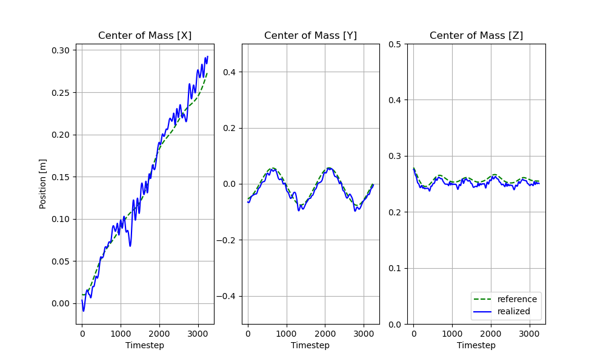
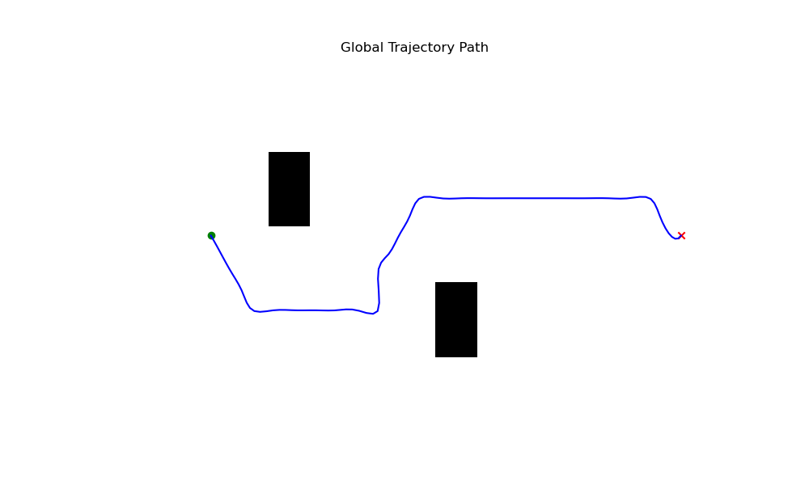

# Pila de Optimización de Trayectorias para Cuadrúpedos
[Alexy Skoutnev](https://alexyskoutnev.github.io/), [Andrew Cinfal](https://github.com/cinaral), [Praful Sigdel](https://praful22.github.io/), [Forrest Laine](https://github.com/forrestlaine)

[Proyecto](https://alexyskoutnev.github.io/Quadruped-Trajectory-Optimization-Stack/) | [arXiv](https://arxiv.org/abs/2309.09058)


## Resumen

Presentamos un nuevo marco de código abierto, Pila de Optimización de Trayectorias para Cuadrúpedos (QTOS), que integra un planificador global, planificador local, simulador, controlador e interfaz de robot en un solo paquete. QTOS funciona como una interfaz completa de extremo a extremo, simplificando la planificación continua de movimientos en una plataforma de cuadrúpedo de código abierto al cerrar la brecha entre el software intermedio (middleware) y la planificación de la marcha. Permite a los usuarios traducir sin esfuerzo objetivos de navegación de alto nivel en comandos de robot de bajo nivel. Además, QTOS mejora la estabilidad y la adaptabilidad de la planificación de marchas a largas distancias en terrenos difíciles.

Si encuentras útil nuestro trabajo en tu investigación o labor, por favor considera [citárnoslo](#citing).

## Dependencias

- Python 3.10 (recomendado)
- [PyBullet](https://github.com/bulletphysics/bullet3/)
- [Towr](https://github.com/ethz-adrl/towr)
- [Docker](https://www.docker.com/)

## Configuración del Entorno
Para ayudar a mantener todos los paquetes juntos en un solo entorno, por favor crea un entorno de conda.

```console
conda create -n QTOS python=3.10
conda activate QTOS
pip3 install -r requirements.txt
pip3 install -e .
```
## Instalación de Docker [Ubuntu]
```console
sudo apt-get update
sudo apt-get install ca-certificates curl gnupg
sudo install -m 0755 -d /etc/apt/keyrings
curl -fsSL https://download.docker.com/linux/ubuntu/gpg | sudo gpg --dearmor -o /etc/apt/keyrings/docker.gpg
sudo chmod a+r /etc/apt/keyrings/docker.gpg
echo \
  "deb [arch="$(dpkg --print-architecture)" signed-by=/etc/apt/keyrings/docker.gpg] https://download.docker.com/linux/ubuntu \
  "$(. /etc/os-release && echo "$VERSION_CODENAME")" stable" | \
  sudo tee /etc/apt/sources.list.d/docker.list > /dev/null
sudo apt-get update
sudo apt-get install docker-ce docker-ce-cli containerd.io docker-buildx-plugin docker-compose-plugin
sudo docker run hello-world
```
## Instalación de Docker [macOS]
```console
sudo hdiutil attach Docker.dmg
sudo /Volumes/Docker/Docker.app/Contents/MacOS/install
sudo hdiutil detach /Volumes/Docker
```

## Instalación de Docker
```console
DOCKER_BUILDKIT=1 docker build --no-cache -t towr -f Dockerfile .
docker run -d towr
```
Ahora deberías tener una imagen de Docker llamada 'towr', que se utilizará en el script main.py dentro del ciclo de planificación continua. Para verificar que el contenedor se creó correctamente, usa el siguiente comando (debería mostrar que el contenedor es un ancestro de la imagen 'towr').
```console
docker ps -f ancestor=towr
```
Para construir un entorno 'towr' con una interfaz gráfica (GUI), necesitarías crear otra imagen llamada 'Dockerfile_GUI'. Sin embargo, esta imagen es lenta y solo debe usarse para depurar el código fuente y los binarios de 'towr'.
```console
DOCKER_BUILDKIT=1 docker build --no-cache -t towr-gui -f Dockerfile_GUI .
docker run -p 6080:80 -v /dev/shm:/dev/shm towr-gui
```
Ahora abre un navegador web y escribe
```
http://localhost:6080/
```
Para iniciar una interfaz visual de towr en la GUI de Docker de Towr, usa los comandos
```console
cd ~/catkin_ws
source /opt/ros/melodic/setup.sh
/opt/ros/melodic/setup.sh >> ~/.bashrc
source ~/.bashrc
catkin_make_isolated -DCMAKE_BUILD_TYPE=Release -j4
source devel_isolated/setup.sh
roslaunch towr_ros towr_ros.launch
```

# Uso

## Ejecución de Demos
Las demos presentadas a continuación muestran las características proporcionadas por QTOS. Para ejecutar una trayectoria de ejemplo y verificar si todo está instalado correctamente, ejecuta el siguiente comando:
```console
cd ~/SOLO12_SIM_CONTROL
python3 scripts/main.py
```
Para explorar las capacidades de planificación de movimiento, puedes ejecutar las siguientes tres tareas de navegación:
- Caminar (exp_1)
- Esquivar (exp_3)
- Escalada (exp_5)

Estas tareas se pueden ejecutar usando los siguientes comandos:
```console
python3 scripts/main.py -exp exp_1
python3 scripts/main.py -exp exp_3
python3 scripts/main.py -exp exp_5
```

## Datos de Seguimiento
QTOS sigue el CoM, Endeffector y los errores del controlador en cada paso de tiempo del simulador, y grafica los datos resultantes en la carpeta `/data/tracking/*`. Ten en cuenta que puedes ver el rendimiento del seguimiento en tiempo real manteniendo las gráficas abiertas mientras ejecutas QTOS. Un ejemplo de la gráfica de seguimiento se presenta a continuación:



## Datos de Navegación
QTOS grafica el plan global resultante en la carpeta `/data/plots/*`. Aquí, puedes ver el mapa booleano, el plan global y el mapa de elevaciones del terreno alrededor del robot. Un ejemplo de un plan global se muestra a continuación:



## Configuración
Todos los archivos de configuración para el simulador y el robot se encuentran en la carpeta `/data/config`. Allí se encuentran dos configuraciones importantes: `solo12.yml` y `experiment_*.yml`. `/data/config/solo12.yml` configura el controlador del robot y las propiedades del hardware (p. ej., ganancias kp, ganancias kd, esquema de control, etc.), mientras que `/data/config/experiment_*.yml` configura el terreno, las propiedades del simulador, la información de seguimiento, etc.


## Citar
```
@misc{skoutnev2023qtos,
   title={Quadruped Trajectory Optimization Stack},
   author={Skoutnev, Alexy and Cinral, Andrew and Sigdel, Praful and Laine, Forrest},
   eprint={2309.09058},
   archivePrefix={arXiv}
   primaryClass={cs.RO}
   year={2023}
}
```
